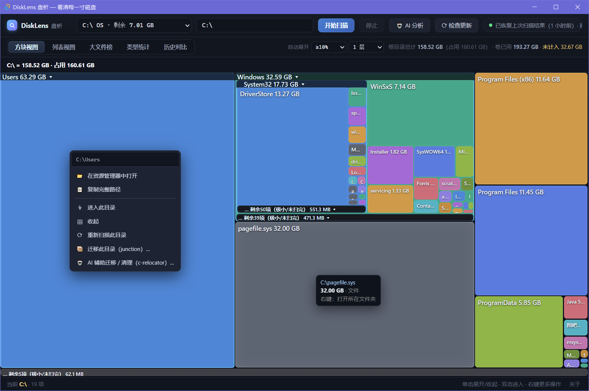
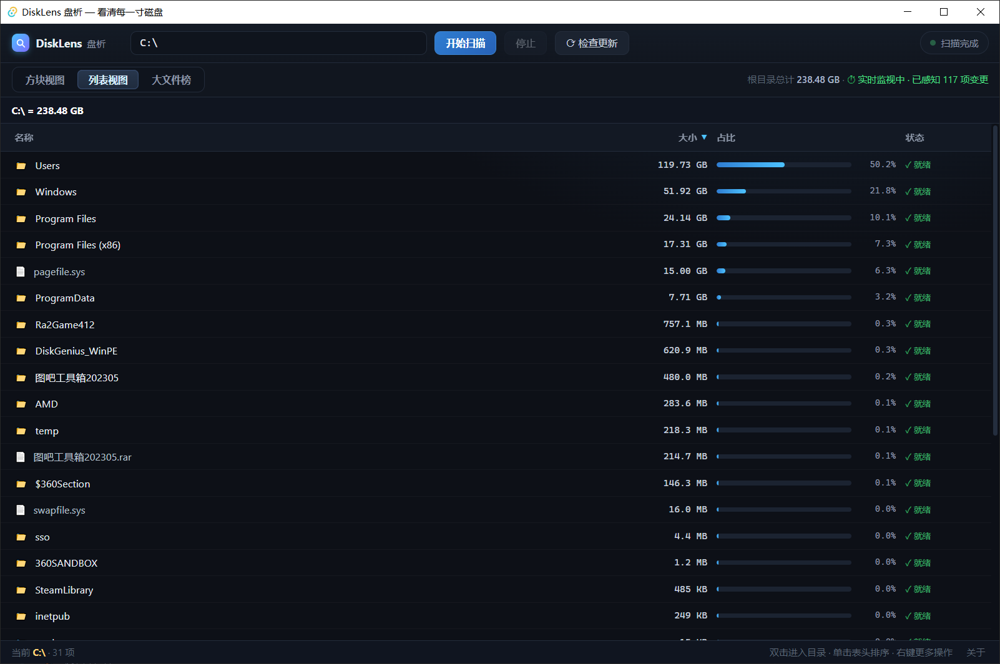
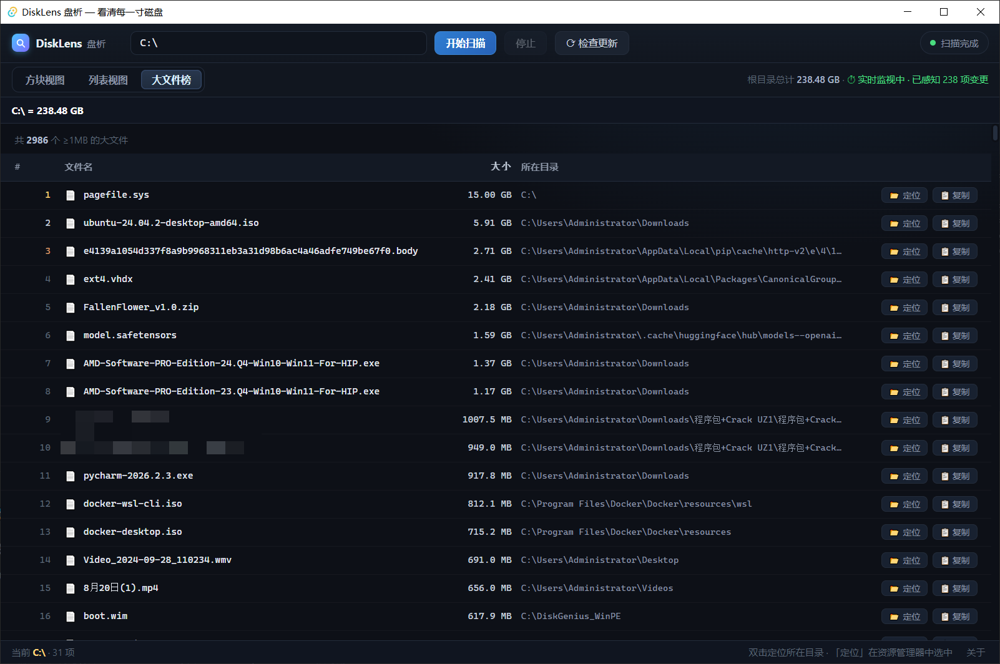

# DiskLens 盘析

> 看清每一寸磁盘 —— 开源的磁盘空间分析器：实时 treemap 方块视图 + 排序列表 + 大文件榜。


**DiskLens** 用一张实时生长的 treemap 把目录占用画出来：谁在吃你的硬盘，一眼可见。
扫描引擎是 Rust 单次 DFS，扫描过程中方块**渐进生长**、越扫越深，不用等扫完才能看。

<p align="center">
  
</p>

## ✨ 功能

- **三种视图，各司其职**
  - 🔲 **方块视图**：squarify treemap，面积即体积；单击展开对比、双击进入、右键更多操作
  - 📋 **列表视图**：名称 / 大小表头点击排序，占比条实时反映父目录构成
  - 🏆 **大文件榜**：全盘 ≥1MB 大文件实时上榜，一键在资源管理器中定位
- **实时流式渲染** —— Rust 并行扫描边扫边推，前端补间动画，扫描未结束即可下钻浏览；
  扫描中点击还没扫到的目录会**优先调度**该子树
- **扫描后实时监视** —— 扫描完成自动监视根目录，文件增删改即时反映到视图和占用统计
- **📦 一键迁移（junction）** —— 右键任意目录迁移到其他盘或任意文件夹：预检 → 复制 → 校验 →
  切换，原位置创建目录联接，程序无感；同卷秒迁，跨卷断点续传，失败源目录原样保留。
  不能自动迁移的（虚拟内存、Docker、WSL 等）直接告诉你要去哪个软件里改
- **🤖 AI 辅助迁移/清理** —— 自动识别目录属于哪个工具（Gradle / pip / Docker / WSL 等 20+ 规则），
  给出推荐动作并生成一条可直接发给 AI 助手的现成指令
  （[c-relocator](https://github.com/AriesYB/c-relocator)，`npx skills add AriesYB/c-relocator`）
- **细节打磨** —— 盘符下拉直达、排序迟滞不跳变、极小项自动折叠为"剩余 N 项"、
  junction/symlink 计 0 不重复计数、系统目录自动跳过、面包屑 + 快捷键导航

<table>
  <tr>
    <td></td>
    <td></td>
  </tr>
</table>

## 🚀 使用方法

### 安装（Windows）

从 [Releases](https://github.com/AriesYB/disklens/releases) 下载：

- `DiskLens_x.y.z_x64-setup.exe` —— 安装版
- `disklens.exe` —— 免安装单文件版，双击即用

> 无需安装任何运行库：Windows 10/11 自带 WebView2，DiskLens 直接可用。

### 基本操作

1. 顶栏下拉选盘符（或直接输入任意路径）→ 点「开始扫描」
2. 单击方块/行展开对比，双击进入目录，右键打开菜单（打开 / 复制路径 / 迁移…）
3. `Backspace` / `Esc` 返回上级，点击面包屑跳转

### 从源码运行

```bash
# 前置：Rust (rustup) + Node.js
npm install
npm run tauri dev    # Windows 桌面客户端，真实扫描
npm run dev          # 浏览器模式：合成数据演示，UI 迭代用
```

打包 exe：`npm run build`，产物在 `src-tauri/target/release/`（单文件 exe 与 NSIS 安装包）。

## 🧬 原理

```
Rust DFS worker                        前端 store（唯一事实源）
  │ read_dir 递归，跳过 reparse point     │ scan-update 事件 → upsert 节点
  │ flush: 32MB / 400项 / 250ms ────────→ │ dirty → 渲染泵 → 按视图绘制
  │ 目录完成推 done                       │   ├ treemap: squarify + 迟滞 + 折叠
  └──────── 单次扫描即树本身 ──────────────┘   ├ list: 排序 + 占比条
                                           └ files: 全局大文件索引
```

- **一次扫描即整棵树**：不存在"展开触发重扫、与主扫描抢 IO"的问题，前端 store 即真相
- **前端零框架**：原生 HTML/CSS/JS，无构建步骤；Tauri 只做壳和事件通道
- 技术细节与平台路线见 [DESIGN.md](DESIGN.md)

## 🗺️ 路线图

| 平台 | 状态 |
|---|---|
| Windows | ✅ 可用 |
| Android | M2（SAF 适配） |
| macOS / Linux | M3（CI 构建） |
| iOS | M4（沙盒内分析） |

## License

[MIT](LICENSE)
