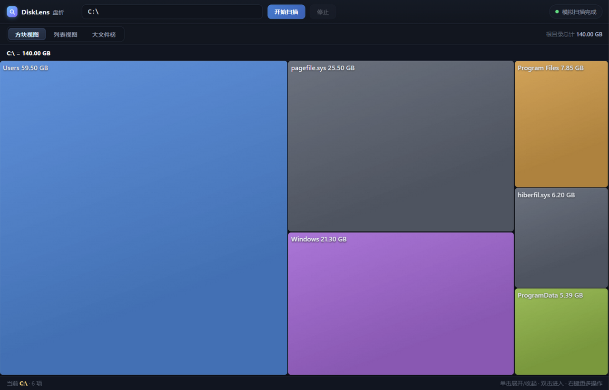
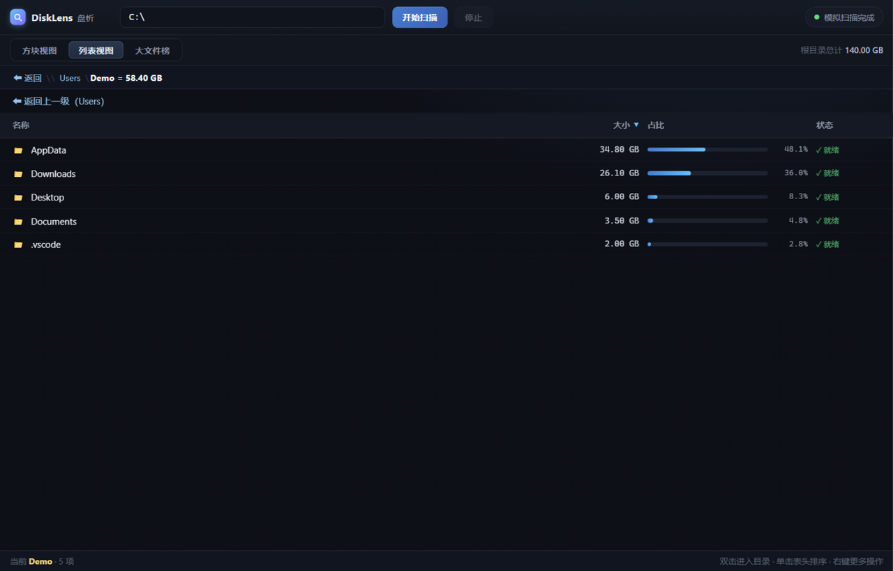
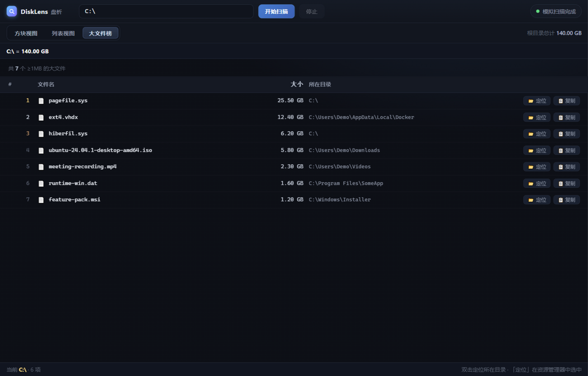

# DiskLens 盘析

> 看清每一寸磁盘 —— 一个开源的磁盘空间分析器：实时 treemap 方块视图 + 排序列表 + 大文件榜。


**DiskLens** 用一张实时生长的 treemap 把目录占用画出来：谁在吃你的硬盘，一眼可见。
扫描引擎是 Rust 单次 DFS，扫描过程中方块**渐进生长**、越扫越深，不用等扫完才能看。

<p align="center">
  
</p>

## ✨ 特性

- **实时流式渲染** —— Rust 并行扫描（多线程工作队列，同一时刻几十个目录并行统计）边扫边推
  （32MB / 400 项 / 250ms 增量 flush），前端补间动画，扫描未结束即可下钻浏览；
  扫描中点击任意还没扫到的目录会**优先调度**该子树，不必等主扫描爬到它
- **三种视图，各司其职**
  - 🔲 **方块视图**：squarify treemap，面积即体积，单击展开对比、双击进入、右键更多操作
  - 📋 **列表视图**：名称 / 大小表头点击排序，占比条实时反映父目录构成
  - 🏆 **大文件榜**：全盘 ≥1MB 大文件 Top 榜，扫描中实时上榜，一键在资源管理器中定位
- **📦 一键迁移（junction 方式）** —— 右键任意目录迁移到其他盘：预检（空间/占用/系统目录）→
  复制 → 校验 → 切换，原位置创建目录联接，程序无感；同卷秒迁，跨卷断点续传，任何失败源目录原样保留。
  不能自动迁移的（虚拟内存、Docker、WSL、被占用文件等）直接告诉你要去哪个软件里改
- **🤖 AI 辅助迁移/清理（c-relocator 联动）** —— 右键 → AI 辅助：自动识别目录属于哪个工具
  （Gradle/Maven/cargo/pip/Go/JetBrains/Docker/WSL 等 20+ 规则），给出推荐动作（官方配置重定向 /
  junction / 清理缓存），并生成一条可直接发给 AI 助手的现成指令。
  skill 安装：`npx skills add AriesYB/c-relocator`（[GitHub](https://github.com/AriesYB/c-relocator)）
- **🔄 应用内自动更新** —— 启动静默检查 + 顶栏手动「检查更新」，发现新版本弹窗后应用内
  下载安装并自动重启（双源：服务器清单优先，GitHub Releases 回退，minisign 签名校验）
- **交互细节打磨**
  - 排序迟滞：方块平滑生长，大小超越相邻 12% 才换位，不跳变
  - 两道防细条：极小项自动折叠为"剩余 N 项"聚合条，杜绝不可读的细条
  - 面包屑导航 + Backspace/Esc 快捷返回 + 右键菜单（打开 / 复制路径 / 进入 / 展开）
  - junction/symlink 计 0：不成环、不重复计数；系统目录（System Volume Information 等）自动跳过

<table>
  <tr>
    <td></td>
    <td></td>
  </tr>
</table>

## 🚀 快速开始

### 下载 exe（Windows）

从 [Releases](https://github.com/AriesYB/disklens/releases) 下载：

- `DiskLens_x.y.z_x64-setup.exe` —— 安装版
- `disklens.exe` —— 免安装单文件版，直接双击运行

> 无需安装任何运行库：Windows 10/11 自带 WebView2，DiskLens 直接可用。

### 从源码运行

```bash
# 前置：Rust (rustup) + Node.js
npm install
npm run tauri dev    # Windows 桌面客户端，真实扫描
npm run dev          # 浏览器模式：合成数据演示，无需 Rust 工具链，UI 迭代用
```

浏览器模式打开 [http://127.0.0.1:5180](http://127.0.0.1:5180) 即自动播放一轮模拟扫描，可体验全部三种视图。

## 📦 打包 exe

```bash
npm run build        # = tauri build
```

产物：

- 免安装单文件：`src-tauri/target/release/disklens.exe`
- NSIS 安装包：`src-tauri/target/release/bundle/nsis/*.exe`

## 🔄 自动更新（v1.0.0 起）

客户端内置更新检查（[tauri-plugin-updater](https://v2.tauri.app/plugin/updater/)）：启动后静默检查一次（失败不打扰），
顶栏「⟳ 检查更新」可手动触发；发现新版本弹窗展示更新说明 → 应用内下载（进度条）→ 被动模式安装 → 自动重启。
更新包经 minisign 签名，客户端内置公钥校验，签名不匹配的包无法安装。

更新源按顺序尝试（前一个非 2XX 才落到下一个）：

1. `https://ikanp.top/downloads/disklens/latest.json` —— 服务器清单
2. `https://github.com/AriesYB/disklens/releases/latest/download/latest.json` —— GitHub 最新 Release 附件

### 发布新版本

```bash
# 1. 升版本号：package.json / package-lock.json / src-tauri/Cargo.toml / src-tauri/tauri.conf.json
# 2. 签名构建（TAURI_SIGNING_PRIVATE_KEY 传密钥“内容”而非路径；私钥在 .tauri/ 下不入库，
#    丢失将无法再向已装用户推更新）
TAURI_SIGNING_PRIVATE_KEY=$(cat .tauri/disklens-updater.key) npm run build
# 3. 生成更新清单
node scripts/gen-updater-manifest.mjs "一句话更新说明"
# 4. 发布：GitHub Release 上传 setup.exe 与 dist/latest.json；
#    服务器把 dist/latest.json 上传到 /usr/share/nginx/ikanp-home/downloads/disklens/latest.json
```

> 服务器 nginx 注意：latest.json 是固定文件名、内容随版本更新，缓存策略须为 no-cache
> （参考 `ikanp-home.conf` 对 HTML 的 `expires -1` 约定），否则老客户端可能长时间读到旧清单。

## 🧪 测试

```bash
npm test             # Rust 单元测试（deny 目录匹配、事件序列化等）
cargo check          # 后端类型检查
```

前端交互可在浏览器模式下人工验证：视图切换、表头排序、双击进入、右键菜单、Backspace 返回。

## 🏗️ 架构

```
Rust DFS worker                        前端 store（唯一事实源）
  │ read_dir 递归，跳过 reparse point     │ scan-update 事件 → upsert 节点
  │ flush: 32MB / 400项 / 250ms ────────→ │ dirty → 渲染泵 → 按视图绘制
  │ 目录完成推 done                       │   ├ treemap: squarify + 迟滞 + 折叠
  └──────── 单次扫描即树本身 ──────────────┘   ├ list: 排序 + 占比条
                                           └ files: 全局大文件索引
```

- **一次扫描即整棵树**：不存在"展开触发重扫、与根 DFS 抢 IO"的问题，前端 store 即真相
- **前端零框架**：原生 HTML/CSS/JS，无构建步骤；Tauri 只做壳和事件通道
- 技术细节与平台路线见 [DESIGN.md](DESIGN.md)

## 🗺️ 路线图

| 平台 | 状态 |
|---|---|
| Windows | ✅ 可用（v0.3：三视图 + junction 迁移） |
| Android | M2（SAF 适配，受系统授权范围限制） |
| macOS / Linux | M3（CI 构建） |
| iOS | M4（沙盒内"选取目录分析"形态） |

计划中：并行遍历 / NTFS MFT 直读加速、体积缓存秒开、历史对比。

## License

[MIT](LICENSE)
